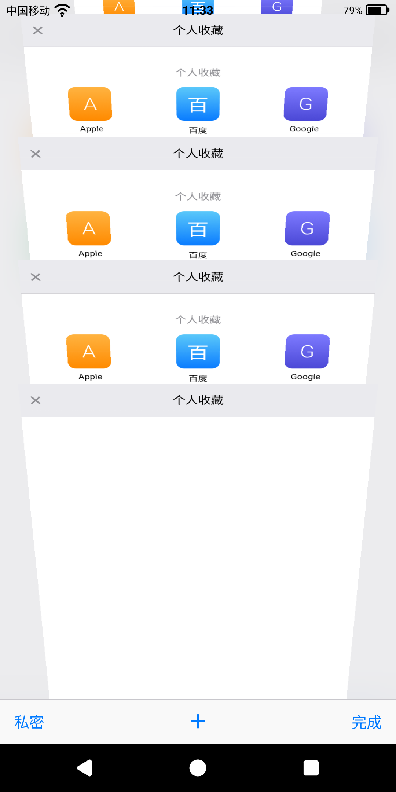

# iOS 7 Safari · Android

**一个致敬 iOS 7 Safari 的玩具浏览器：用 Kotlin 和原生 View，把 2013 年那套「抽屉」任务视图逐帧复刻到了 Android 上。**

点一下标签按钮，整张网页会「塌」成一张带俯角的倒梯形卡片，落进卡片堆里；点卡片，它又拉伸回一整页。
没有 Compose，没有 Material Design，没有第三方 UI 库 —— 只有 Canvas、`Path`、位图，和一套自己算的透视几何。

[](#构建与运行)
[](#技术说明)
[](#极致轻量)
[](LICENSE)

<sub>[English](#english) · [特色](#功能与特色) · [功能清单](#功能清单) · [技术说明](#技术说明) · [构建](#构建与运行) · [架构文档](docs/ARCHITECTURE.md)</sub>

> 项目主页（截图 + 常见问题，手机上看更舒服）：<https://wzy2233.github.io/ios7-safari-android/>

---

## 这是什么

一个跑在 Android 上的**仿 iOS 7 Safari 浏览器**，纯属玩具，也纯属致敬。

> 如果你是在找「**安卓上类似 Safari 的浏览器**」「iOS 风格浏览器」「iOS 7 浏览器复刻」，那大概就是它：
> 界面照 2013 年那台机器做，交互（尤其是标签页）按 Safari 的手感调。

2013 年的 iOS 7 是扁平化设计的起点：毛玻璃、细发丝线、蓝色丝带，还有那个把网页变成一叠卡片的标签视图。
那些东西在当年是「设计」，十年后再看更像一种手艺 —— 这个项目就是想把那套手艺，用 Android 的画笔重新做一遍。

所以它**不是**换皮主题，也不是套壳浏览器：

- 地址栏会随手指滚动**收缩 / 舒张**（44dp ↔ 24dp），网页跟着压上去，而不是重新排版；
- 顶栏、底栏一起淡出，**视线全部让给内容**，往回滑一点就长回来；
- 点标签按钮，**当前网页本身**塌成倒梯形卡片，落进卡片堆；
- 卡片可以左滑删除、长按拖动换位（像两块木板互相挤开）、滚出屏幕缩到 1/9、拖到尽头整摞橡皮筋让位。

代码约 **7.4k 行 Kotlin**，安装包 **1.7MB**。每一处数值在 [架构文档](docs/ARCHITECTURE.md) 里都能查到「为什么是这个数」。

---

## 截图

<p align="center">
  
</p>

<p align="center"><sub>任务视图：卡片带真实俯角、越远越小；标题条像打印纸一样"吐"出来；一屏正好 4 张</sub></p>

> 截图是开发早期在 1080p 屏上截的，起始页磁贴内容都一样。欢迎 PR 换上更漂亮的截图。
>
> 不想装 APK 也可以先看界面：[`preview/index.html`](preview/index.html) 是纯 HTML 的静态预览，浏览器直接打开即可（只有布局与配色，没有真实动画）。

---

## 功能与特色

### 1. 抽屉式的 3D 任务视图（这个项目的主菜）

iOS 7 Safari 的标签视图不是"缩略图列表"，而是**一叠有厚度、有俯角的卡片**：越靠后的卡片越小、越暗，标题条像打印纸一样从卡片顶端"吐"出来。这里把它逐帧复刻了：

- **整页形变**：动画里的那张卡片不是缩略图，是**当前页面的真实像素**。截图后交给自绘 View 逐条带做透视绘制，动画期间 WebView 完全不动、不重绘；
- **真实透视**：用针孔相机模型（焦距 / 相机距离 / 俯角 / 视高）算梯形，卡片位置、缩放、遮光深度都由同一个投影推导，改一个常量全场景自洽；
- **能上手玩**：左滑删除（整张跟手，不淡出）、长按拖动换位（三态自走，像两块木板互换）、滚出屏幕缩到 1/9、拖到尽头整摞橡皮筋让位并 3D 俯身；
- **一屏 4 张**，卡片数量变化时其余卡片动画补位，绝不"啪"地跳一下。

### 2. 和 Safari 几乎一样的 UI

不是"像浏览器"，是照着 2013 年那台机器做的：

- 顶栏 44dp、底栏 44dp、发丝分割线 0.5dp，配色 `#F9F9F9` / `#007AFF`；
- 底栏五个图标（后退 / 前进 / 分享 / 书签 / 标签）全是 Canvas 画的，不是位图；
- 地址栏是个胶囊：非编辑态**文字水平居中**，点一下蓝丝带铺开、文字左对齐、浮动「取消」出现；
- 加载进度条是顶部一条 2.5dp 的细线，加载完有一个收尾动画；
- 文本选择菜单、链接长按菜单都是自建的 `PopupWindow`（屏蔽系统 ActionMode，去掉选择手柄），因为系统菜单长得完全不像 iOS。

### 3. 顶栏底栏自动收起

往上滑，顶栏从 44dp 收成 24dp：胶囊底和刷新按钮**一起淡出**，只留网址本身，字号从 18sp 收到 14sp；底栏同时压到 0 并淡出。往下滑一点，整段反着来。

关键是它**不会让网页重新排版**：

- WebView 的视口从头到尾不变，只用 `translationY` 跟手（纯 GPU 变换，文字不会因此发毛）；
- 位移取**整数像素**，并且与顶栏底边严格相等 —— 否则网页里 `position: sticky` 的顶栏会跟着"抽搐"（这条坑在架构文档里有完整推导）；
- 收缩带 20/8dp 滞回，手指在临界点轻微抖动时不会来回跳。

### 4. 地址栏动画

点地址栏，胶囊左边距从"按文字宽度算出的居中位置"开始，蓝色丝带 300ms 铺满整条；文字左对齐、字号微微上浮、「取消」从右侧淡入。退出时反向收回，全程同一条苹果曲线 `PathInterpolator(0.25, 0.1, 0.25, 1)`。

### 5. 任意网页都能双指放大

移动版网站经常用 `user-scalable=no` / `maximum-scale=1` 锁死缩放，桌面版页面又会因为强制缩放被撑爆。这里的做法是：页面加载后注入一段 JS，**保留网站原本的 `width` 和 `initial-scale`**，只把 `maximum-scale` 放宽到 6、去掉 `user-scalable=no`。所以任何网页都能捏合放大，又不会把版式搞乱。

### 6. 新标签页 / 起始页

本地 HTML 起始页，3×3 共 9 个磁贴，favicon 拿不到就露出首字母色块（按域名取色）。点「＋」新建标签页时，新页面会先"飞"进卡片堆，**落位之后才开始加载** —— 这样飞入动画里不会是一张白页。

点地址栏，先给的是「个人收藏」磁贴页（不管栏里现在是网址还是空）；只有真的开始打字，才切成搜索建议（搜索词 / 网址 + 书签与历史匹配）。

### 7. 书签 / 阅读列表 / 历史

iOS 7 那种三段式切换控件（书签 / 阅读列表 / 历史），支持编辑、删除、清空。数据存在 `SharedPreferences` 里，序列化成 JSON，不需要数据库。

### 8. 分享

iOS 风格**底部动作面板**：上面一行是系统里真实可分享的 App（图标取自缓存，主线程不查包、不加载图标），下面一行是浏览器自己的功能 —— 书签 / 添加到阅读清单 / 添加到主屏幕 / 复制 / 打印。

### 9. 隐私模式

点一下左下角，整个界面切成深色。和别的浏览器不同：**页面和标签全部保留**（不销毁 WebView、不清标签），只是换一套配色，并且此后不再记录历史。

### 10. 极致轻量

| 项 | 值 |
|---|---|
| 安装包 | **1.7MB**（1,744,402 字节） |
| 依赖 | 只有 `androidx.core:core-ktx`，**零第三方 UI 库** |
| 浏览器内核 | **调用系统 WebView**，不打包 Chromium |
| 图标 | 矢量（`VectorDrawable`），5 个密度的 PNG 从 409KB 压到 **3.4KB** |
| 界面 | 播放器、模糊、卡片、渐变、分享图标全部自绘 |

一个现代浏览器动辄几十上百 MB，是因为它自带内核。这个项目只有 1.7MB，因为它**不重复造内核** —— Android 每个系统里都已经有一个 WebView 了。

### 11. 一堆"只有真机上才看得见"的细节

- 手势：屏幕边缘 36dp 起手，右滑后退 / 左滑前进；高速甩动时接管 WebView 的惯性（初速打折、指数衰减、撞边冲过头不回位）；
- 模糊：进任务视图时，把背景缩小到 1/4 做两次一维盒式模糊，全程在后台线程，用序号丢弃过期结果；
- 起飞帧用 `PixelCopy` 读 GPU 合成后的真实像素，不在点击那一帧去软件绘制 WebView（那样会明显卡一下）；
- 共享菜单、错误页、进度条、加载失败、`target=_blank`、下载、外链，都按 iOS 7 的样子处理。

---

## 功能清单

### 地址栏

| 功能 | 说明 |
|---|---|
| 只显示域名 | 自动去掉 `www.`，起始页显示为空 |
| 点击铺开 | 蓝色丝带从胶囊里长出来、文字左对齐、浮动「取消」出现，全程 300ms |
| 非编辑态居中 | 按文字宽度算 `padStart`，不靠 `gravity` |
| 网址 / 搜索判定 | 含空格或非域名字符 → 搜索；默认搜索引擎**必应** |
| 加载中变 ✕ | 只有"真正在加载网页"时才变停止键；起始页常驻刷新键 |
| iOS 文本菜单 | 自建 `PopupWindow`（全选 / 复制 / 粘贴…），屏蔽系统 ActionMode，去掉选择手柄 |
| 随滚动收缩 | 44dp → 24dp，带 20/8dp 滞回，避免临界点抖动 |

### 网页

| 功能 | 说明 |
|---|---|
| iOS 7 User-Agent | 让网站吐出移动版页面 |
| 双指缩放 | 注入 JS 放宽 `maximum-scale`，保留原版式（见特色 5） |
| 边缘滑动导航 | 屏幕边缘 36dp 起手，右滑后退 / 左滑前进 |
| 自定义惯性 | 高速甩动时接管 `WebView` 的 fling |
| 链接菜单 | 长按链接 / 图片 → iOS 风格气泡菜单（新标签打开、复制、下载…） |
| `target=_blank` | 拦截 `onCreateWindow`，不跳出应用 |
| 下载 / 外链 | `DownloadListener` + 交给系统浏览器 |
| 失败页 | 自己画的错误页，不是系统的"网页无法打开" |
| 历史记录 | 页面加载完成即记；私密模式不记 |
| 进度条 | 顶部 2.5dp（iOS 7 的细线），加载完成有个收尾动画 |

### 任务视图

| 功能 | 说明 |
|---|---|
| 倒梯形卡片 | 逐条带透视绘制，带真实俯角与近大远小 |
| 一屏 4 张 | 卡片高度按数量均分，多了就滚动 |
| 点卡片展开 | 卡片拉伸成整页，收尾那一帧与 WebView 严丝合缝 |
| ＋ 新建 | 新标签页"飞"进卡片堆，落位后才开始加载 |
| 左滑删除 | 整张跟手，不淡出；删完其余卡片动画补位 |
| 长按换位 | 三态自走：抬起 → 让开 → 落位；只动这两张的层级 |
| 滚出缩放 | 越过 1/9 线开始缩小，越远越小 |
| 橡皮筋 | 拖到尽头整摞让位（`stackShift`），松手弹回带过冲 |
| 三维俯身 | 拖到极限时俯角再加 10°，像把手机倾过来看 |
| 私密模式 | 只换配色，**标签和页面全部保留** |

### 起始页 / 书签

| 功能 | 说明 |
|---|---|
| 本地 HTML 起始页 | 3×3 共 9 个磁贴，favicon 拿不到就露首字母色块 |
| 点地址栏 → 收藏页 | 先给「个人收藏」；真的开始打字才切成搜索建议 |
| 搜索建议 | 搜索词 / 网址一行 + 书签与历史匹配 |
| 书签三段 | 书签 / 阅读列表 / 历史，支持编辑、删除、清空 |
| 分享面板 | iOS 风格动作面板：真实可分享 App + 书签 / 阅读清单 / 主屏幕 / 复制 / 打印 |

---

## 技术说明

### 一句话架构

**一个 Activity + 四张全屏浮层 + 一个「英雄视图」承载所有页面 ⇄ 卡片的形变。**

```
┌──────────────────────────────────────────┐
│ 顶栏 44dp（地址栏 / 丝带 / 取消）           │  ← 随手指在 44↔24dp 之间插值
├──────────────────────────────────────────┤
│ WebView (weight=1)                        │  ← 视口固定，只用 translationY 跟手
├──────────────────────────────────────────┤
│ 底栏 44dp（后退 / 前进 / 分享 / 书签 / 标签）│  ← 同时压到 0 并淡出
└──────────────────────────────────────────┘
        ↑ 之上叠浮层：任务视图 / 书签页 / 搜索建议 / 分享面板
```

### 模块

| 文件 | 行数 | 职责 |
|---|---:|---|
| `MainActivity.kt` | 6385 | 全部业务、状态机、动画编排、自绘控件 |
| `TrapezoidView.kt` | 346 | 透视绘制：`TrapezoidView`（英雄/卡片共用）、`Trap`（投影数学） |
| `TabScrollView.kt` | 198 | 任务视图滚动容器：越界回调 + 自定义惯性 |
| `ObservableWebView.kt` | 152 | 网页滚动回调 + 同一套惯性 |
| `ShareGlyphView.kt` | 164 | 分享图标（Canvas 画的，不是位图） |
| `Store.kt` | 110 | 书签 / 阅读列表 / 历史（SharedPreferences + JSON） |
| `UrlEditText.kt` | 50 | 无选择手柄的地址输入框 |
| `SineOutInterpolator.kt` | 16 | `f(t) = sin(t·π/2)` |

### 三个值得看的地方

**① 形变为什么不用 `View` 的 `scale` / `rotation`**

`WebView` 是硬件层，做不了梯形透视（那是非仿射变换）。所以走的是「**截真实像素 → 逐条带绘制**」：

```kotlin
// 每帧只改这几个参数，绘制在 TrapezoidView.onDraw 里逐条带贴图
k           // 透视强度（焦距 / 相机距离）
hStart      // 条带顶端的"屏幕内高度"（俯角越大，上边越扁）
hEnd        // 条带底端高度
theta       // 俯角
overlayFrac // 标题条"打印纸"吐出的进度
```

**② 地址栏收缩，为什么网页不重新排版**

改 `WebView` 的 `layoutParams.height` 会每帧触发重排重绘，滚动立刻变卡。这里**视口固定**，只改 `webContainer.translationY`；而且必须是整数、且与顶栏底边严格相等：

```kotlin
private fun barBottomY(p: Float): Int = dp(44f - 20f * p)                  // 顶栏整数高
private fun webTyPx(p: Float): Float = (barBottomY(p) - dp(24f)).toFloat() // 网页层位移
```

较真到 1px 的原因：网页里 `position: sticky` 的顶栏一般会被提升成独立合成层，它按**整数像素**吸附；外层若在亚像素上连续移动，两层每帧错开半像素 —— 观感就是网页自己的顶栏在抽搐。

**③ 卡片一多就卡，卡在哪**

一张卡片位图是 `1036 × 1755 × 4B ≈ 7.3MB`（1080p 屏，1:1 渲染，为了不降清晰度）。20 个标签就是 140MB+，每次开任务视图都要重新分配、旧的全部回收 —— 卡的是 **GC**，不是算力。

处理方式：**懒渲染**（只为视口上下 1~2 屏内的卡片生成位图，远处 `bitmap = null`，滚到附近再补，且每帧最多补一张）+ `trimCardCache()` 用 `HashSet` 保护正在显示的位图 + 遮光深度**量化到 1px**。

> 这也是为什么这个项目**没有**引入 Rust / NDK：瓶颈是位图内存和 View 重录，Skia 早已在 native 层做完 GPU 加速，换成 JNI 只会多一层边界开销。

### 体积是怎么省下来的

| 手段 | 效果 |
|---|---|
| 不打包内核，调用系统 WebView | 省掉 60~100MB |
| 零第三方 UI 库（连 `RecyclerView` 都没用） | dependencies 只有 1 个 |
| 图标矢量化 | 409KB → 3.4KB |
| 界面全部 Canvas 绘制 | 没有一张装饰性位图 |
| 渐变 / 圆角用 `GradientDrawable` / `Path` | 不需要 9-patch |

现在的 1.7MB 里，`classes.dex` 压缩后占 1.41MB（Kotlin 标准库 + 全部业务），资源只有 82KB。开 R8 还能再小一截，见路线图。

更多细节（坐标系统、图层树、30 多条动画参数、几何推导、踩过的坑）见 **[docs/ARCHITECTURE.md](docs/ARCHITECTURE.md)**。

---

## 构建与运行

**要求**：JDK 17+、Android SDK 34、Android 8.0（API 26）以上真机或模拟器。

```bash
git clone https://github.com/wzy2233/ios7-safari-android.git
cd ios7-safari-android
./gradlew assembleDebug
adb install -r app/build/outputs/apk/debug/app-debug.apk
```

Windows 下用 `gradlew.bat assembleDebug`。也可以直接用 Android Studio 打开（Ladybug 及以上）。

| 项 | 值 |
|---|---|
| 语言 / UI | Kotlin 2.0.21 / 纯 Android View |
| Gradle / AGP | 8.9 / 8.7.2 |
| compileSdk / targetSdk | 34 / 34 |
| minSdk | 26 |
| 依赖 | 仅 `androidx.core:core-ktx` |

---

## 已知限制

- **代码集中**：`MainActivity.kt` 6.4k 行，职责混在一起（历史原因，一天天迭代出来的）。拆分是路线图第一项，但会动到几乎每个动画。
- **内核随系统**：不打包 Chromium，能力受设备 WebView 版本限制（老机器上可能不支持某些新特性）。
- **只针对竖屏手机**：横屏 / 平板没有适配。
- **没有**：标签同步、扩展、广告拦截、阅读模式、下载管理。
- **分享面板的 App 列表取自缓存**：新装的应用要等下次重建列表才会出现。
- 起始页靠 favicon 服务拿图标，离线时只显示首字母色块。

## 路线图

- [ ] 拆 `MainActivity`：状态机 / 动画 / 自绘控件 分成独立类
- [ ] 标签页持久化（杀进程后恢复）
- [ ] 深色模式（私密模式已有一套配色，可复用）
- [ ] 横屏与平板布局
- [ ] 起始页磁贴可编辑（增删排序）
- [ ] 开 R8（`minifyEnabled` + `shrinkResources`），把包再压小

## 贡献

Issue / PR 都欢迎。改动画相关的代码前，建议先读 [docs/ARCHITECTURE.md](docs/ARCHITECTURE.md) 的「关键坑」和「改代码前的检查清单」两节 —— 那里记着一堆"看起来能简化、一改就抖"的地方。

## 关键词

`Android` `Kotlin` `浏览器` `Browser` `WebView` `iOS 7` `iOS7` `Safari` `仿 iOS` `UI 复刻` `Clone`
`任务视图` `Tab Switcher` `卡片式多标签` `3D 卡片` `抽屉特效` `形变动画` `Morph Animation` `自定义 View` `Canvas`
`透视投影` `手势` `惯性滚动` `Fling` `高斯模糊` `双指缩放` `隐私模式` `阅读列表` `书签` `开源`
`安卓浏览器` `类似 Safari` `iOS 风格浏览器` `iOS 7 复刻` `Android 仿 iOS`

> 建仓时建议填的 GitHub Topics（仓库首页右上角 ⚙️ → Topics）：
>
> ```
> android kotlin browser webview ios7 safari ui-clone android-browser
> custom-view canvas animation tab-switcher morph
> ```

---

## 许可与声明

[MIT](LICENSE) © 2026 wzy2233

- 这是一个**玩具项目**，写给自己的致敬作：为了记住 2013 年那套设计有多讲究，也为了练手 Android 的自定义 View 和动画。
- 与 Apple Inc. **没有任何关系**，未获其授权，也不是官方产品。
- 仓库内**不包含** Apple 的任何素材：图标是照着旧版位图重新量、重新绘制的矢量；界面元素全部用 Android 原生绘制；字体使用系统字体；没有使用任何 Apple 字体文件或图片资源。
- "Safari"、"iOS" 是其各自权利人的商标，此处仅用于说明复刻对象。
- 仅供学习 Android 自定义 View、动画与几何计算之用；请勿用于商业用途。

<a id="english"></a>

## English

A toy browser for Android that recreates **iOS 7 Safari** — a tribute to Apple's design, written in Kotlin with plain Android Views. No Compose, no third-party UI libraries, 7.4k lines of code, **1.7 MB** APK, powered by the system WebView.

The centerpiece is the tab switcher: the *actual page* collapses into a perspective trapezoid card and drops into a stack, like a drawer. Tapping a card stretches it back into a full page, with no visual discontinuity in between. Everything is drawn slice-by-slice through a pinhole-camera projection inside a custom `View` (`TrapezoidView`) — the `WebView` never moves or redraws during the animation.

Also included: a Safari-like UI drawn entirely on Canvas, auto-collapsing top/bottom bars (fixed viewport, integer-pixel translation), pinch-zoom on any page (viewport rewriting that keeps the original layout), bookmarks / reading list / history, an iOS share sheet, private browsing, and a local HTML start page with a 3×3 tile grid.

Read the deep dive (Chinese) in **[docs/ARCHITECTURE.md](docs/ARCHITECTURE.md)**.

```bash
./gradlew assembleDebug   # JDK 17+, Android SDK 34, API 26+
```

MIT licensed. Unofficial fan project, not affiliated with Apple; no Apple assets are bundled.
